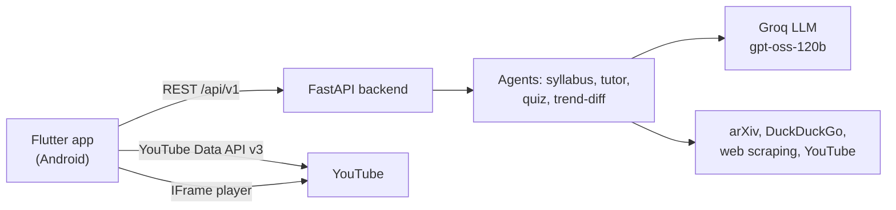

# Learnly AI: Project Summary, PRD & TRD

*As of 16 October 2026*

## Overview

Learnly AI is an Android-first learning app that turns any technical topic into a structured, up-to-date course in under a minute. A learner types a topic and gets a roadmap of 3–4 modules. Each lesson can be studied in five formats: AI tutor chat, flashcards, in-app YouTube videos, arXiv papers or a long-form article. An AI-graded quiz closes each module.

**Problem:** self-taught engineers piece courses together from scattered videos, docs and papers, and static courses go stale within months. Learnly pulls current material from the web each time. Its "trend radar" keeps the roadmap fresh by flagging new developments.

**Status:** working prototype. A Flutter app (Material 3, light and dark) talks to a FastAPI backend that uses Groq for generation. The app fetches videos directly from the YouTube Data API and plays them in-app with YouTube's official player. Learner stats and the review deck are still sample data.

## Product requirements (PRD)

**Target users**

- Working and aspiring software / AI engineers learning a new technology on their own.
- Students who want a structured path through a fast-moving field (RAG, agents, Flutter, distributed systems).
- Learners with a preferred format: some read, some watch, some learn by being quizzed.

**Goals**

1. Generate a personalised roadmap from a topic, experience level (Beginner → Staff/Research), preferred format and optional goals.
2. Teach each subtopic in five formats, switchable at any time.
3. Check understanding with module quizzes; passing one unlocks the next module.
4. Keep content current by syncing new papers, releases and trends into the roadmap.

**Core features**

| Feature | What the learner gets | Status |
| --- | --- | --- |
| Syllabus generator | 3–4 sequential modules, 2–3 subtopics each, with time estimates and attached resources | Built |
| AI tutor | Socratic chat per subtopic, with quick prompts and suggested follow-ups | Built |
| Videos | 3 relevant, embeddable YouTube tutorials per subtopic, played in-app | Built |
| Papers & article | arXiv papers with abstracts; a long-form article with copyable code | Built |
| Flashcards | Flip cards with "Got it / Review later" and a mastery progress bar | Built |
| Module quiz | AI-generated questions, scored, with per-question explanations and coaching | Built |
| Trend radar | One-tap sync that flags new developments and marks updated subtopics | Built |
| Progress & profile | Streak, study time, XP, quiz average, skill levels | Sample data |

**Main flow:**
1. Enter a topic on Home.
2. Choose level and format; the roadmap is generated.
3. Open a subtopic in the Learning Studio and switch formats as needed.
4. Mark the subtopic complete.
5. Take the module quiz; passing unlocks the next module.

**Success metrics (proposed targets)**

- Time from entering a topic to the first lesson: under 60 s for the typical (median) user.
- Share of learners who take the module quiz after finishing its subtopics.
- Quiz pass rate on the first or second attempt.
- 7-day return rate.

**Out of scope for this version:** user accounts and cloud sync, social features, iOS release, payments, offline-first content.

## Technical requirements (TRD)

The system is a Flutter app plus a stateless FastAPI service. The backend coordinates the AI agents and web sources. The app calls YouTube directly, so videos work even when the backend is unreachable.

**Tech stack**

| Layer | Technology |
| --- | --- |
| Mobile app | Flutter 3.38 / Dart 3.10, Riverpod 3, Material 3 theme generated from one seed colour, `http`, `flutter_markdown`, `url_launcher`, `youtube_player_iframe` 6 |
| Backend | Python, FastAPI + Uvicorn, Pydantic v2 schemas |
| AI model | Groq Cloud (`openai/gpt-oss-120b`) for syllabus, lessons, tutor and quizzes; Gemini SDK included for embeddings |
| Web sources | YouTube Data API v3, arXiv, DuckDuckGo search, BeautifulSoup scraping, YouTube transcripts |

**Backend modules**

- **Agents:**
  - `syllabus_agent`: builds the curriculum from the topic plus scraped trends, with a rule-based fallback.
  - `tutor_agent`: lesson content and Socratic chat.
  - `quiz_agent`: generates and grades questions.
  - `trend_diff_agent`: detects new developments.
- **Services:**
  - `groq_service`: AI model calls that return structured JSON.
  - `scraper_service`: web, arXiv and articles.
  - `youtube_service`: tries the YouTube API, then DuckDuckGo, then a plain search link.
  - `rag_service`.

**API (base `/api/v1`)**

| Method | Path | Purpose |
| --- | --- | --- |
| POST | `/syllabus/generate` | Build a roadmap from topic, level, style and goals |
| POST | `/syllabus/sync-trends` | Refresh a roadmap with new developments |
| GET | `/learn/lesson` | Lesson content for one subtopic and format |
| POST | `/learn/chat-tutor` | One tutor reply with follow-up questions |
| GET | `/quiz/module` | Generate a module quiz |
| POST | `/quiz/submit` | Score answers; return explanations and coaching |
| GET | `/profile/analytics` | Learner stats |
| GET | `/videos/youtube` | Video search (alias `/videos/search`) |
| GET | `/ai/info` | Model and key configuration status |

**Data model**
- A `Syllabus` holds `Module`s, each tracked as unlocked or passed.
- A `Module` holds `Subtopic`s, with completed status, minutes and a trend-updated flag.
- A `Subtopic` holds `ResourceItem`s: videos, papers and articles.
- `TopicLessonContent` holds one subtopic's markdown, dialogue, resources, code snippets and flashcards.
- `Quiz` and `QuizResultResponse` carry the questions and per-question evaluations.
- Progress lives in app memory; there is no database yet.

**Mobile app**
- Main tabs: Home, Roadmap, Review and Progress. The Learning Studio, quiz and video player open as separate screens, and there are three bottom sheets (new topic, profile, trend radar).
- If the backend is unreachable, the app shows local sample content.
- Alongside each lesson request, the app searches YouTube from the phone. The API key comes from `config/keys.json` at build time (`--dart-define-from-file=config/keys.json`).

**Non-functional requirements**

- **Platform:** Android 7.0+ (minSdk 24). Widget tests check layouts at 320 dp width and 1.3× font scale.
- **Timeouts:** 12 s for backend calls, 10 s for YouTube.
- **YouTube quota:** 100 units per search against 10,000 free per day, which covers about 50–100 lessons a day.
- **Secrets:** the Groq key stays on the server. The YouTube key ships inside the APK, so it must be restricted to YouTube Data API v3.

## Risks, gaps and next steps

The biggest gap is reach. On a phone, everything except videos depends on a backend running on the developer's PC.

| Risk or gap | Impact | Next step |
| --- | --- | --- |
| Backend runs only locally | Tutor, roadmap and quiz fall back to sample content on a real device | Host the FastAPI service (e.g. Cloud Run or Render) behind HTTPS |
| Silent offline fallback | Learners see sample content without knowing it | Show an "Offline: sample content" banner |
| No saved progress or accounts | Progress is lost when the app restarts | Save progress on the device first, then add accounts with cloud sync |
| Hardcoded stats and review deck | Progress screens don't reflect real learning | Calculate stats from quiz results and completed subtopics |
| Roadmap reuses the same 3 videos | Videos attached to roadmap subtopics may not match them | Run a separate search per subtopic, in parallel |
| YouTube key inside the APK | Anyone can extract the key and use up its quota | Restrict the key; move search behind the hosted backend |
| AI output quality and cost | Inaccurate or inconsistent lessons and quizzes | Check AI output against the expected format, test with a fixed set of topics, cache responses |
