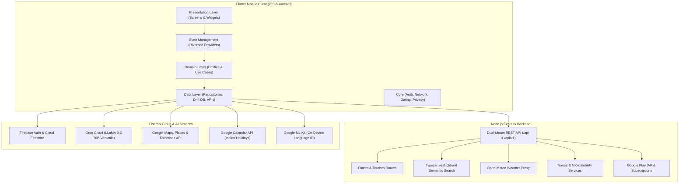

# 🇮🇳 WanderPal India — Comprehensive Feature Catalog & Technical Architecture

> **Application Overview**: WanderPal India is an enterprise-grade travel companion application designed specifically for tourists and travelers exploring India. It seamlessly merges AI trip planning, real-time navigation, Indian cultural intelligence, multilingual voice translation, and travel safety into a cohesive cross-platform mobile experience.

---

## 🏛️ System Architecture Overview

---

## 1. 🚀 Onboarding, Authentication & User Management

### 1.1 Fluid Onboarding Flow
- **Location**: [`OnboardingFlow`](file:///d:/WanderPal%20India/WanderPal_india/lib/presentation/onboarding_flow/onboarding_flow.dart)
- **Features**:
  - **4-Stage Interactive Walkthrough**:
    1. *Welcome to Wander Pal*: Introduction to exploring iconic Indian landmarks and hidden local favorites.
    2. *Discover Places You'll Love*: Highlights recommendations and location collection disclosures with prominent background location transparency.
    3. *Plan Smarter, Not Harder*: Previews AI adaptive itinerary generation based on style and budget.
    4. *Ready to Explore?*: Direct conversion gate leading to login and account creation.
  - **Dynamic Theme Shifting**: Background ambient glow smoothly interpolates across custom accent colors (`#3B82F6`, `#8B5CF6`, `#10B981`, `#F59E0B`) as pages change.
  - **Haptic Feedback**: Tactile ticks during page snapping and action taps.

### 1.2 Authentication & Security
- **Location**: [`FirebaseAuthService`](file:///d:/WanderPal%20India/WanderPal_india/lib/core/services/firebase_auth_service.dart), [`LoginScreen`](file:///d:/WanderPal%20India/WanderPal_india/lib/presentation/login_screen/login_screen.dart), [`SignupScreen`](file:///d:/WanderPal%20India/WanderPal_india/lib/presentation/signup_screen/signup_screen.dart)
- **Features**:
  - **Multi-Provider Auth**:
    - Email & Password with real-time validation and error parsing.
    - Google Sign-In with OAuth credential linking.
    - Phone Number Authentication with international country code picker (`+91` default).
    - Guest / Anonymous Browsing mode for instant app exploration.
  - **Biometric Security**: Fingerprint / Face ID unlock integration.
  - **Secure Storage**: Sensitive auth tokens stored in encrypted platform keychains via [`SecureStorageService`](file:///d:/WanderPal%20India/WanderPal_india/lib/core/services/secure_storage_service.dart).

### 1.3 Post-Auth Routing & Profile Setup Wizard
- **Location**: [`PostAuthGuard`](file:///d:/WanderPal%20India/WanderPal_india/lib/core/guards/post_auth_guard.dart), [`ProfileSetupScreen`](file:///d:/WanderPal%20India/WanderPal_india/lib/presentation/profile_setup/profile_setup_screen.dart)
- **Features**:
  - **Intelligent Gatekeeper**: Differentiates between newly registered travelers and returning users; routes new users directly to the personalization wizard.
  - **4-Step Personalization Wizard**:
    1. *Personal Details*: Name, avatar image upload, phone number, bio.
    2. *Travel Interests*: Multi-select chips for Culture, Food, Adventure, Nature, Nightlife, Spiritual, and Budget preferences.
    3. *Dream Destinations*: Destination selection across Indian states and hubs (Delhi, Mumbai, Jaipur, Agra, Goa, Kerala, Varanasi, etc.).
    4. *Profile Ready*: Celebration screen syncing data to Cloud Firestore and redirecting to the main dashboard.

---

## 2. 📱 Main Dashboard & Real-Time Context

- **Location**: [`MainDashboard`](file:///d:/WanderPal%20India/WanderPal_india/lib/presentation/main_dashboard/main_dashboard.dart)
- **Features**:
  - **Adaptive Header & Location Detection**:
    - Automatic GPS detection via Geolocator.
    - Dynamic location switcher modal with quick-select Indian metros (New Delhi, Mumbai, Bengaluru, Jaipur, Varanasi).
  - **Live Weather Hub**:
    - [`EnhancedWeatherWidget`](file:///d:/WanderPal%20India/WanderPal_india/lib/presentation/main_dashboard/widgets/enhanced_weather_widget.dart) displaying current temperature, apparent "feels-like" temp, humidity, precipitation chance, UV index, and weather condition badges.
    - AI-generated smart weather tips (clothing recommendations, best time for outdoor visits).
  - **Quick Actions Grid**:
    - Direct shortcuts to Maps Navigation, Emergency SOS, Voice Translator, AI Trip Planner, Nearby Attractions, Festival Tracker, and India Guide.
  - **AI Travel Recommendations**:
    - Dynamic recommendation cards generated via Groq AI based on the user's selected preferences.
  - **India Overview Section**:
    - Highlights national overview data (population, iconic cultural traits, seasonal travel tips) served directly from the backend.
  - **Recent & Active Trips**:
    - Live itinerary cards showing active trip progress and direct "Resume Trip" navigation.
  - **Dynamic Notification Drawer**:
    - Real-time notifications for schedule delays, weather warnings, and festival alerts.

---

## 3. 🗺️ Interactive Maps, Routing & Navigation System

- **Location**: [`MapsAndNavigation`](file:///d:/WanderPal%20India/WanderPal_india/lib/presentation/maps_and_navigation/maps_and_navigation.dart), [`NavigationPage`](file:///d:/WanderPal%20India/WanderPal_india/lib/presentation/maps_and_navigation/pages/navigation_page.dart)

### 3.1 Google Maps Engine & Custom Overlays
- **Interactive Map Canvas**: Smooth 60fps pan, zoom, tilt, and rotation gestures with custom night/day map styles.
- **Dynamic Category Markers**: Color-coded markers for Heritage monuments, Restaurants, Scenic spots, Transit hubs, and Accommodations.
- **Marker Clustering**: [`MarkerClusterService`](file:///d:/WanderPal%20India/WanderPal_india/lib/core/services/marker_cluster_service.dart) prevents visual clutter when hundreds of attractions are in viewport.

### 3.2 Multi-Waypoint Route Optimization
- **Location**: [`RouteOptimizerService`](file:///d:/WanderPal%20India/WanderPal_india/lib/services/route_optimizer_service.dart), [`MapMultiWaypointSheet`](file:///d:/WanderPal%20India/WanderPal_india/lib/presentation/maps_and_navigation/widgets/map_multi_waypoint_sheet.dart)
- **Features**:
  - Solves the Traveling Salesperson Problem (TSP) to order multiple tourist stops in the most time- and distance-efficient sequence.
  - Live recalculation of ETA, total distance, and alternative route polylines.

### 3.3 Turn-by-Turn GPS Navigation
- **Navigation Mode**: Full-screen Google Maps style navigation UI (`#1976D2` blue banner).
- **Maneuver Guidance**: Real-time icon arrows (turn left, right, keep straight, roundabouts), street names, remaining step distance, and total destination ETA.
- **Voice Guidance**: Native TTS alerts reading out navigation maneuvers.
- **Rerouting**: Detects off-route movement and recalculates optimal paths automatically.

### 3.4 Transit & Micromobility Integration
- **Locations**: [`TransitService`](file:///d:/WanderPal%20India/WanderPal_india/lib/services/transit_service.dart), [`MicromobilityService`](file:///d:/WanderPal%20India/WanderPal_india/lib/services/micromobility_service.dart)
- **Features**:
  - Transit schedules and routes for major Indian Metros (Delhi Metro, Mumbai Local, Bengaluru Namma Metro).
  - Micromobility overlay mapping local e-rickshaw stands, shared bicycle points, and scooter stations.

### 3.5 Supplementary Map Sheets
- **Place Details Sheet**: Deep dive into ratings, operating hours, photo galleries, entry fees, and user reviews.
- **Nearby Along Route**: Find fuel pumps, restrooms, cafes, or ATMs directly on the calculated route without deviating significantly.
- **Arrival Experience Sheet**: Pops up upon destination arrival with parking guidance and ticketing information.
- **Offline Maps**: Cached map viewports for travel in low-connectivity areas.

---

## 4. 🤖 AI Travel Assistant ("Wander")

- **Location**: [`AiTravelAssistantChat`](file:///d:/WanderPal%20India/WanderPal_india/lib/presentation/ai_travel_assistant_chat/ai_travel_assistant_chat.dart), [`ChatService`](file:///d:/WanderPal%20India/WanderPal_india/lib/services/chat_service.dart)
- **LLM Engine**: Groq Cloud running **LLaMA 3.3 70B Versatile** (with streaming responses).

### 4.1 Personality & Capabilities
- **Persona**: Named **"Wander"**, an enthusiastic, knowledgeable local friend who speaks conversationally, gives genuine recommendations, warns about tourist traps, and suggests authentic hidden gems.
- **Trip Context Awareness**: Ingests active trip data from [`travelContextProvider`](file:///d:/WanderPal%20India/WanderPal_india/lib/providers/travel_context_provider.dart) (destination, days remaining, budget, companions, upcoming stops) so advice is automatically personalized.
- **Quick Suggestion Chips**:
  - 🏝️ *"Where should I travel next?"*
  - 💰 *"Budget travel tips for India"*
  - 🍜 *"Best local street food spots"*
  - 🎒 *"Packing essentials for current season"*
  - ⚡ *"Weekend getaway ideas"*
  - 🛡️ *"Solo travel safety tips"*

### 4.2 Chat UX & Persistence
- **Streaming Responses**: Real-time token streaming with animated typing indicators.
- **Rich Markdown Formatting**: Bold highlights, bulleted lists, and formatted links.
- **Message Operations**: Copy message, retry on failure, and clear conversation history.
- **Cloud Persistence**: Conversations synced to Cloud Firestore under user sessions.

---

## 5. 🗓️ AI Trip Planner & Generator

- **Location**: [`AiTripPlanner`](file:///d:/WanderPal%20India/WanderPal_india/lib/presentation/ai_trip_planner/ai_trip_planner.dart), [`GroqService`](file:///d:/WanderPal%20India/WanderPal_india/lib/services/groq_service.dart)

### 5.1 Plan Configuration Matrix
- **Destination**: Any city, state, or region in India.
- **Duration**: Flexible range from 1 to 30 days.
- **Budget Tiers**: Budget (₹), Moderate (₹₹), Luxury (₹₹₹), Ultra-Luxury (₹₹₹₹).
- **Travel Styles**: Relaxed, Balanced, Adventure, Fast-paced.
- **Interest Profiles**: Heritage & Culture, Food & Culinary, Wildlife & Safaris, Nature & Treks, Art & Museums, Nightlife, Spiritual & Wellness.
- **Custom Prompts**: Specific likes/must-sees, dislikes/things to avoid, accessibility constraints, and preferred transit modes.

### 5.2 Structured Output Generation
- Generates valid, validated JSON containing:
  - Catchy itinerary title and theme.
  - Day-by-day sequence of activities with exact timestamps (e.g., 09:00 AM).
  - Activity duration, estimated cost in INR, location coordinates (lat/long), category badge, travel time to next stop, and curated photography URLs.
- Seamless "One-Click Save" directly transferring the plan to the Live Itinerary system.

---

## 6. ⏱️ Live Dynamic Itinerary Management

- **Location**: [`LiveItineraryPage`](file:///d:/WanderPal%20India/WanderPal_india/lib/presentation/live_itinerary/live_itinerary_page.dart), [`ItineraryProvider`](file:///d:/WanderPal%20India/WanderPal_india/lib/presentation/live_itinerary/provider/itinerary_provider.dart)
- **Features**:
  - **Interactive Day Timeline**: Visual chronological cards showing morning, afternoon, and evening activities with connecting transport steps.
  - **Schedule Delay & Alert Monitoring**: Detects when activities run over time and dynamically suggests schedule compression or postponements.
  - **Activity Actions**:
    - Mark activities as completed (with visual strikethrough).
    - Add custom activities on the fly.
    - Edit start times and durations.
    - Delete unwanted items.
  - **Cross-Feature Handoff**:
    - Tap "Navigate" on any activity to launch Google Maps turn-by-turn directions.
    - Tap "Ask Wander" to query the AI assistant about tips for that specific monument or venue.
  - **Local Persistence**: Full offline capability via SQLite / Drift database.

---

## 7. 🗣️ Voice & Text Multilingual Translator

- **Location**: [`VoiceTranslator`](file:///d:/WanderPal%20India/WanderPal_india/lib/presentation/voice_translator/voice_translator.dart), [`TranslationService`](file:///d:/WanderPal%20India/WanderPal_india/lib/services/translation_service.dart)

### 7.1 Language Support
- **40+ Languages Supported**: Comprehensive coverage of major Indian languages:
  - Hindi (हिंदी), Bengali (বাংলা), Telugu (తెలుగు), Marathi (मराठी), Tamil (தமிழ்), Urdu (اردو), Gujarati (ગુજરાતી), Kannada (ಕನ್ನಡ), Malayalam (മലയാളം), Odia (ଓଡ଼ିଆ), Punjabi (ਪੰਜਾਬੀ).
  - Major international languages (English, Spanish, French, German, Italian, Japanese, Korean, Arabic, etc.).

### 7.2 Translation Features
- **On-Device Language Identification**: Uses Google ML Kit to detect spoken or typed language without network latency.
- **Voice Recognition (STT)**: Real-time speech input with microphone wave visualization via `speech_to_text`.
- **Text-to-Speech (TTS)**: High-fidelity native speech output via `flutter_tts` so locals can listen to translated phrases.
- **Offline Phrasebook**: Locally cached emergency and traveler phrases stored in SharedPreferences.
- **Conversation History**: Scrollable dialog history for seamless two-way conversations between travelers and locals.

---

## 8. 🪔 Indian Cultural Festival Tracker

- **Location**: [`FestivalTracker`](file:///d:/WanderPal%20India/WanderPal_india/lib/presentation/festival_tracker/festival_tracker.dart), [`FestivalService`](file:///d:/WanderPal%20India/WanderPal_india/lib/services/festival_service.dart)

### 8.1 Festival Intelligence
- **Deep Cultural Profiles**: Covers India's iconic cultural celebrations:
  - *Diwali* (Festival of Lights), *Holi* (Festival of Colors), *Durga Puja* (Kolkata's UNESCO heritage celebration), *Ganesh Chaturthi* (Mumbai processions), *Pushkar Camel Fair* (Rajasthan), *Onam* (Kerala boat races), *Hornbill Festival* (Nagaland), *Kumbh Mela*, *Eid*, and *Christmas*.
- **Rich Festival Details**:
  - Cultural significance, origin myths, and traditional rituals.
  - Best cities and specific locations for authentic celebrations.
  - Traveler etiquette, photography guidelines, and safety tips for large crowds.

### 8.2 Smart Google Calendar API Syncing
- **Once-a-Year Sync Architecture**: Automatically syncs against the official Google Calendar Indian Holidays API (`en.indian#holiday@group.v.calendar.google.com`) only once per calendar year.
- **Zero Quota Waste**: Local cache in SharedPreferences ensures instantaneous load times and zero network overhead on subsequent visits.
- **Filter & Search**: Filter by geographic zone (North, South, East, West, Cultural Fairs) or instant text search.

---

## 9. 📖 India Travel Guide & Cultural Encyclopedia

- **Location**: [`IndiaTravelGuideScreen`](file:///d:/WanderPal%20India/WanderPal_india/lib/presentation/india_travel_guide/india_travel_guide_screen.dart)
- **Content Scope**: 1,380+ lines of specialized, offline-ready advice across 10 vital domains:

| Category | Icon | Key Topics & Guidance |
| :--- | :---: | :--- |
| **Culture & Etiquette** | 🙏 | Temple entry rules, removing footwear, Namaste greetings, head coverings, right-hand dining rule. |
| **Transit & Trains** | 🚆 | IRCTC train booking, Vande Bharat Express, AC 2-Tier/3-Tier, metro cards, prepaid auto-rickshaws, Uber/Ola. |
| **Food & Health** | 🍲 | Street food safety, mineral vs RO water, avoiding Delhi belly, probiotic curd/lassi, hygienic stalls. |
| **Money & Payments** | 💳 | UPI digital payments, QR codes, currency exchange rules, ATM safety, courteous market bargaining. |
| **Monuments & Heritage**| 🏰 | ASI online ticketing, sunrise photography timings, official licensed guides, modest dress codes. |
| **Wildlife & Safaris** | 🐯 | Jim Corbett, Ranthambore, Kaziranga, online safari booking rules, naturalist etiquette. |
| **Himalayan Treks** | 🏔️ | Ladakh & Valley of Flowers, altitude sickness (AMS) acclimatization, packing thermal layers. |
| **Wellness & Ayurveda** | 🧘 | Rishikesh yoga schools, authentic Kerala Ayurvedic Panchakarma, monsoon rejuvenation. |
| **Safety & Emergency** | 🛡️ | National Emergency 112, women's helpline 1090, avoiding unmetered taxis, emergency contacts. |

---

## 10. 🔎 Discover Attractions & AI Semantic Search

- **Locations**: [`DiscoverAttractions`](file:///d:/WanderPal%20India/WanderPal_india/lib/presentation/discover_attractions/discover_attractions.dart), [`DiscoveryPage`](file:///d:/WanderPal%20India/WanderPal_india/lib/presentation/discovery/discovery_page.dart), [`SearchEngineScreen`](file:///d:/WanderPal%20India/WanderPal_india/lib/presentation/search_engine/search_screen.dart)

### 10.1 Discovery Engine
- **Nearby Places Retrieval**: Pulls live tourist spots, viewpoints, historical architecture, nature parks, and dining options within a customizable radius (1 km to 50 km).
- **Advanced Filtering**: Filter by category chips, rating thresholds (e.g., 4.5+ stars), open-now status, and pricing tiers.
- **Dual Presentation**: Toggle effortlessly between vertical card list view and full-screen map pin view.

### 10.2 Semantic & Natural Language Search
- **Backend Vectors**: Backed by **Typesense** and **Qdrant** vector database pipelines.
- **Natural Language Intent**: Supports expressive queries like *"peaceful sunset spot with great coffee"* or *"historic palace with rooftop dining"* instead of simple keyword matching.
- **Favorites & Bookmarking**: One-tap heart button syncing saved spots directly to Cloud Firestore via [`FavoritesNotifier`](file:///d:/WanderPal%20India/WanderPal_india/lib/providers/favorites_provider.dart).

---

## 11. 🚨 Emergency SOS & Safety Hub

- **Location**: [`QuickActionsGridWidget`](file:///d:/WanderPal%20India/WanderPal_india/lib/presentation/main_dashboard/widgets/quick_actions_grid_widget.dart), [`EmergencyContactsWidget`](file:///d:/WanderPal%20India/WanderPal_india/lib/presentation/user_profile/widgets/emergency_contacts_widget.dart)
- **Features**:
  - **One-Tap Direct Calling**:
    - **112**: All-in-One National Emergency Helpline.
    - **100**: Police Department.
    - **108 / 102**: Ambulance & Medical Emergency.
    - **1091 / 1090**: Women's Safety Helpline.
    - **1393**: Tourist Advisory & Support Helpline.
  - **Instant Location Broadcast**: One-click sharing of real-time GPS coordinates via SMS or WhatsApp to designated emergency contacts.
  - **Custom Emergency Contacts**: Add family and friends with custom names and relationships stored locally and synced to user profile.

---

## 12. 👤 User Profile, Privacy & Settings

- **Location**: [`UserProfile`](file:///d:/WanderPal%20India/WanderPal_india/lib/presentation/user_profile/user_profile.dart)

### 12.1 Account & Personalization
- Full profile editor with image picker, name, phone, bio, and home city.
- Travel stats dashboard showing completed trips, visited destinations, and saved favorites count.

### 12.2 Privacy & Security Control Center
- **Location Permissions**: In-app switch to toggle background location tracking on or off.
- **Data Saver Mode**: Extends cache duration (from 10 mins to 30 mins) and throttles network payload sizes for users traveling on roaming data.
- **Biometric Lock**: Protects user itinerary and profile with fingerprint/face authentication.
- **Cloud Sync**: All privacy toggles sync bi-directionally with Firestore via [`PrivacySettingsService`](file:///d:/WanderPal%20India/WanderPal_india/lib/core/services/privacy_settings_service.dart).

### 12.3 Internationalization & Localization
- **11 Fully Localized Languages**: English, Hindi (हिंदी), Swedish (Svenska), German (Deutsch), French (Français), Spanish (Español), Italian (Italiano), Portuguese (Português), Japanese (日本語), Korean (한국어), Arabic (العربية).
- **RTL Support**: Full Right-to-Left layout mirroring when Arabic is selected.
- **Reactive Updates**: Changing language updates every screen instantly without app restarts via [`LanguageReactiveWidget`](file:///d:/WanderPal%20India/WanderPal_india/lib/routes/app_routes.dart#L138).

### 12.4 Hidden Developer Menu
- Tapping the app version 7 times unlocks the [`DeveloperMenuSheet`](file:///d:/WanderPal%20India/WanderPal_india/lib/presentation/developer/developer_menu_sheet.dart).
- Allows toggling `Premium Override` to unlock all Pro/subscription features locally for testing.

---

## 13. 💳 Monetization, Subscriptions & AdMob

- **Locations**: [`SubscriptionPage`](file:///d:/WanderPal%20India/WanderPal_india/lib/presentation/subscription/subscription_page.dart), [`SubscriptionCheckoutScreen`](file:///d:/WanderPal%20India/WanderPal_india/lib/presentation/payment/pages/subscription_checkout_screen.dart), [`AdMobService`](file:///d:/WanderPal%20India/WanderPal_india/lib/services/admob_service.dart)

### 13.1 Tiered Entitlements (`EntitlementService`)
- **Free Tier**: Access to core maps, standard places search, basic weather, and community travel guide. Ad-supported.
- **Wander Pro Tier**:
  - Unlimited AI Trip Planner generations with Groq LLaMA 3.3.
  - Real-time turn-by-turn voice navigation.
  - Multi-waypoint route optimization (TSP).
  - Offline maps download.
  - Ad-free experience.
- **Billing Cycles**: Monthly and Annual plans with transparent cancellation terms.

### 13.2 Payment Gateways & Store In-App Purchases
- **Google Play In-App Billing / Apple StoreKit**: Native IAP processing via [`IapService`](file:///d:/WanderPal%20India/WanderPal_india/lib/services/iap_service.dart).
- **Stripe & Digital Wallets**: Credit/Debit cards, Google Pay, and Apple Pay via [`PaymentService`](file:///d:/WanderPal%20India/WanderPal_india/lib/services/payment_service.dart).

### 13.3 Non-Intrusive Monetization
- Centralized [`AdMobService`](file:///d:/WanderPal%20India/WanderPal_india/lib/services/admob_service.dart) managing banner ads, interstitials, and rewarded videos with automatic debug-mode test unit IDs.

---

## 14. 🛠️ Backend Microservices & API Architecture

- **Root Location**: `backend/src/index.js`
- **Port & Protocol**: Express REST API running on port 3000, supporting both `/api` and `/api/v1` routes.

| Endpoint Route | Handled Service & Capabilities |
| :--- | :--- |
| `/api/places` | Tourism data, monuments, restaurants, accommodations, attractions, and cultural points of interest. |
| `/api/search` | Geocoding and reverse geocoding via OpenStreetMap / Nominatim. |
| `/api/search/ai`| AI Semantic Vector Search powered by Typesense and Qdrant. |
| `/api/weather` | Open-Meteo weather forecast proxy with server-side caching. |
| `/api/transit` | Bus, train, and metro lines with route coordinate mappings. |
| `/api/micromobility` | Real-time vehicle availability, e-rickshaws, bike stands, and battery swapping stations. |
| `/api/subscriptions` | In-app purchase receipt validation, subscription lifecycle, and webhooks. |
| `/api/roles` | Firebase Admin RBAC role verification and custom claim updates. |
| `/api/ai` | Server-side proxy for Groq AI completions and itinerary generation. |
| `/health` | High-availability health check monitoring Firebase Admin, memory cache, and uptime. |

---

## 15. 🛡️ Resilience, Performance & Infrastructure

- **Centralized HTTP Client**: [`HttpClientService`](file:///d:/WanderPal%20India/WanderPal_india/lib/core/services/http_client_service.dart) and [`DioFactory`](file:///d:/WanderPal%20India/WanderPal_india/lib/core/network/dio_factory.dart) configuring custom retry interceptors (`RetryInterceptor`), auth token injection, and structured logging.
- **Lazy Initialization Engine**: [`LazyInitializationService`](file:///d:/WanderPal%20India/WanderPal_india/lib/core/services/lazy_initialization_service.dart) loads non-critical modules (Weather, Translation, Maps) on demand to guarantee sub-second cold app launches.
- **Performance Telemetry**: [`PerformanceMonitoringService`](file:///d:/WanderPal%20India/WanderPal_india/lib/core/services/performance_monitoring_service.dart) captures screen transition times, API latency, and memory drops.
- **Global Error Boundary**: [`CustomErrorWidget`](file:///d:/WanderPal%20India/WanderPal_india/lib/widgets/custom_error_widget.dart) intercepts uncaught rendering errors with user-friendly recovery screens.
